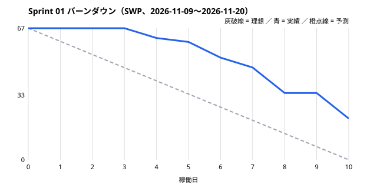
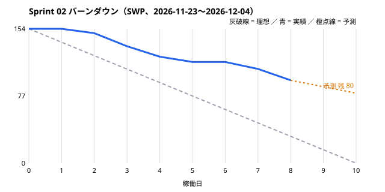

# 進捗報告 — Sprint 01〜02（模擬）

**Iteration（Project の `Sprint` 欄）:** Sprint 01（完了）・Sprint 02（進行中）
**模擬した期間:** 2026-11-09〜2026-12-02（Sprint 02 は 10 稼働日のうち 8 日目時点。最終日は 12-04）
**データの出所:** GitHub Project <https://github.com/users/duongnh-0155/projects/1> を 2026-10-14 に取得して集計（[sim/status.json](sim/status.json)）。進捗と日付は LAB-5 用の架空の値。

## 1. 状態

Project 全体（Epic を除く 389 件）。SWP は葉（子を持たない Issue・sub-issue）だけを合計した（親は子の合計のため二重計上しない）。

| 状態 | 件数 | SWP 合計 | 備考 |
|---|---|---|---|
| Done | 18（葉 17） | 105 | Sprint 01 の 6 件（46 SWP）＋ Sprint 02 の 11 件（59 SWP）。クローズ済み |
| In Review | 2（葉 2） | 21 | #59 RBAC 判定層、#120 PARTY_DB DDL。12/04 までに完了見込み |
| In Progress | 6（葉 5） | 53 | #65 FE アプリ基盤（約 50%）、#121、#215、確認 2 件（#116・#211） |
| Blocked | 2（葉 2） | 16 | #71 移行元データ未着、#165 社外アカウントの初期パスワード経路が未回答 |
| Todo | 20（葉 18） | 161 | Sprint 03 の計画 17 件（156 SWP）と Sprint 02 の未着手 1 件（#52） |
| Backlog | 341（葉 297） | 4055 | Sprint 04 以降 |
| **合計** | **389** | **4411** | 完了 105 SWP（2.4%） |

Sprint 02 の内訳（持ち越し 3 件を含めて計 154 SWP）:

| 状態 | SWP |
|---|---|
| Done | 59 |
| In Review | 21 |
| In Progress | 53 |
| Blocked | 16 |
| Todo | 5 |

## 2. バーンダウン

**Sprint 01:** 計画 67 SWP に対し完了 46（69%）。最初の 3 日は環境の立ち上げで消化がなく、階段状になった。
#56（年度パーティション・DB ロール、13 SWP）は、会計年度の開始月（#69 の確認項目 XC-16）が未回答で複合 FK を確定できず、Sprint 02 へ持ち越した。
確認 Issue 2 件（#69・#21、計 8 SWP）も顧客回答待ちで持ち越し。

**Sprint 02（8 日目）:** 計画 154 SWP（新規 133 ＋持ち越し 21）に対し完了 59、残り 95。
1 日あたり約 7.4 SWP の消化で、最終日の予測は完了 74〜80 SWP（レビュー中 21 が通れば上限側）、**約 75 SWP を Sprint 03 へ持ち越す見込み**。
計画が新規 133 に持ち越し 21 を上乗せしたことと、ブロック 2 件（16 SWP）が主な差。

**リリース全体（SWP 残量）:**

| 時点 | 計画の残量 | 実績・予測の残量 | 差 |
|---|---|---|---|
| 開始時 | 4,411 | 4,411 | 0 |
| Sprint 01 終了（11-20） | 4,344 | 4,365 | +21 |
| Sprint 02 終了（12-04） | 4,211 | 約 4,290（予測） | 約 +80 |
| Sprint 18 終了（2027-07-18、開発完了の目安） | 1,762 | — | — |
| Sprint 28 終了（2027-12-05） | 0 | — | — |

計画そのものが、開発完了の目安（Sprint 18。その後 UAT・移行リハーサルを経て 2027-08-09 稼働）の時点で 1,762 SWP（40%）を残している。これはリスク 1 で扱う。

## 3. 遅延リスク

| リスク | Issue | 影響するマイルストーン | 対応 | 担当・期限 |
|---|---|---|---|---|
| 1. **BE の工数が要員計画を超え、全体が Sprint 28 まで延びる。** 見積 9,194h のうち BE 系が約半分で、BE 3 名は Sprint 03 から常に満杯 | 全体（BE が担当する Issue） | 開発完了 Sprint 18（2027-07-18）、稼働 2027-08-09 | ① BE を 1 名増員（試算で完了 Sprint 24）② オフライン継続（#291、LAB-1 で削減候補 1 位）を稼働後へ回す（両方で Sprint 23）③ それでも残る分は、稼働範囲を Critical 画面に絞る段階リリースを発注者に提案 | PM。12-09 の運営会議で①②を決定、③は 12-16 に発注者へ提示 |
| 2. **完納奨励金の計算が稼働後に落ちている。** 計画では #173 INC-03 が Sprint 21〜22、受入テスト #207（DS-INC-EDGE-01）が Sprint 25 | #173、#207、#90、#374、#211 | 受入基準 DS-INC-EDGE-01 の合格（稼働条件） | INC-03・DLV-03・STL-08 を帳票系より優先し Sprint 10 へ前倒し。テスト期待値の原本（INC-Q の INC-18）の回答期限を 2027-02-26 で合意 | PM・BE-2。12-07 の Sprint 03 計画で並べ替え、BrSE が 12-10 までに期限を合意 |
| 3. 社外アカウントの初期パスワード設定・再発行の経路が未定義で、社外 110 名のログインを作れない | #165（IAM-29）、#123、#144 | Sprint 05（2027-01-04〜）の社外ログイン | 12-03 の定例でエスカレーション。回答がなければ「メール OTP で初回設定」の仮定（PREMISE A-71 の運用）で実装し、回答後に差分を出す | BrSE（12-03）、PM が 12-16 に仮定で進めるか判断 |
| 4. 移行元データが届かず、プロファイリングに着手できない | #71、後続 #74 | データ移行の方針確定（Sprint 06）、移行リハーサル | 正式な提供依頼（期限 12-11）。遅れる場合は FY2026 分のサンプルで先に着手 | PM。12-04 に依頼書を送付 |
| 5. 持ち越しが増えている（Sprint 01 達成率 69%、Sprint 02 予測 約 50%） | Sprint 03 の 17 件 | Sprint 03 以降の各マイルストーン | Sprint 03 の約束を持ち越し込みで 110 SWP 程度に抑え、持ち越し分を先に終える。ブロック中の Issue は約束に含めない | PM（スクラムマスター役）。12-07 の Sprint 03 計画 |
| 6. FE アプリ基盤の遅れ（約 50%） | #65 → #143 ほか Sprint 03 の画面 | Sprint 03 の画面実装 | FE-1 がペアで支援し 12-04 までに完了。間に合わない場合、Sprint 03 の画面は静的レイアウトから先に着手 | FE-1・FE-2。12-04 |
